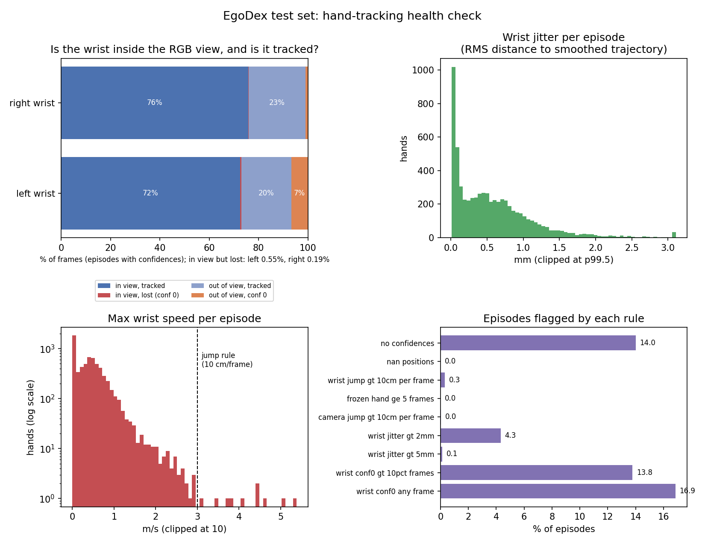
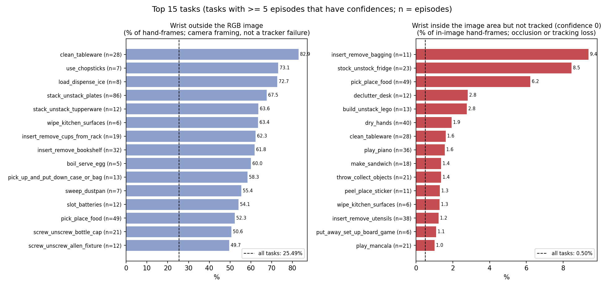
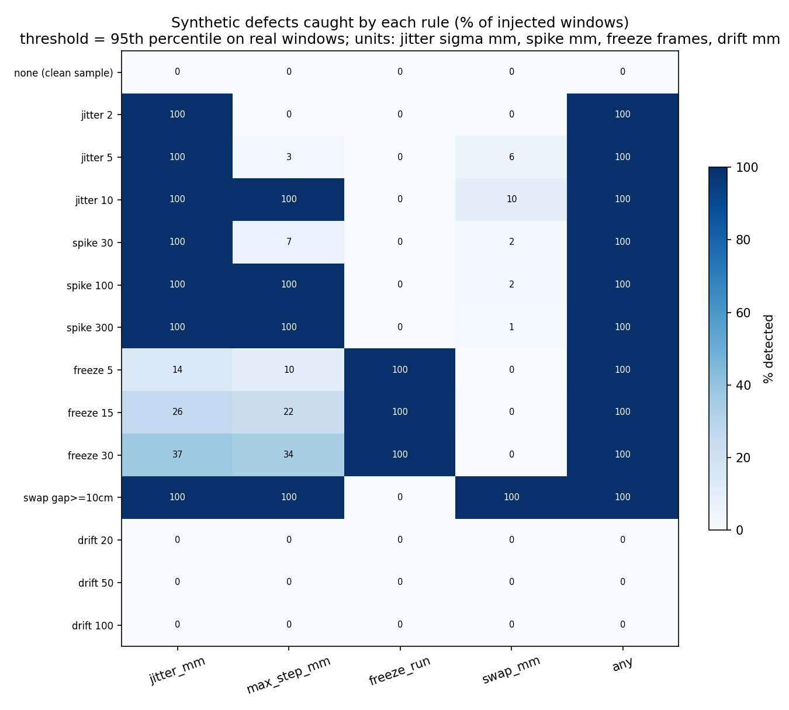
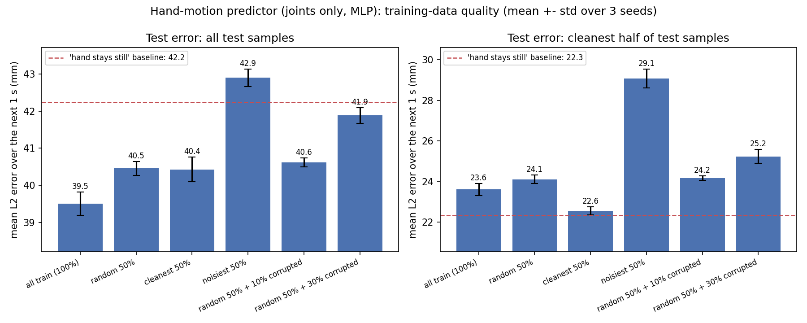
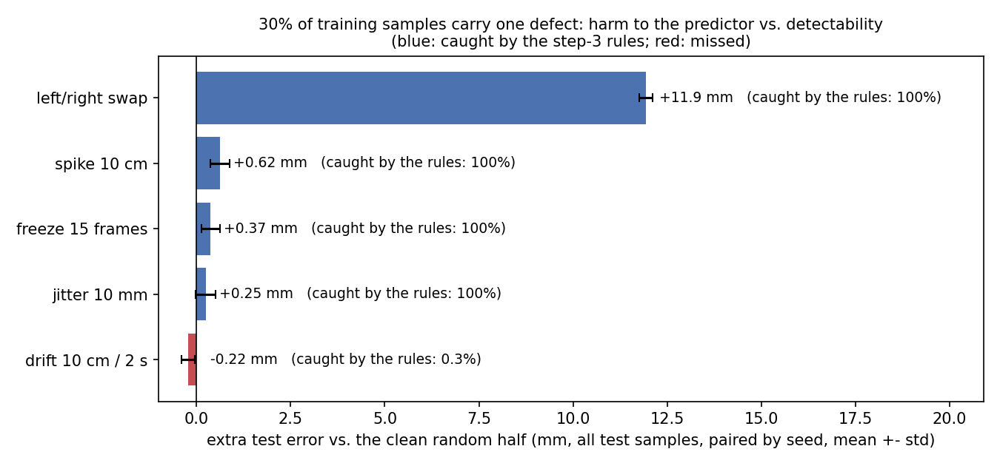
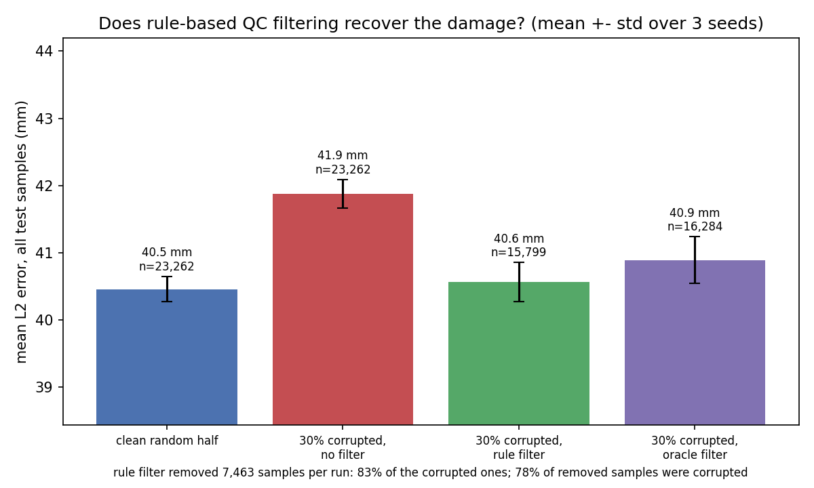
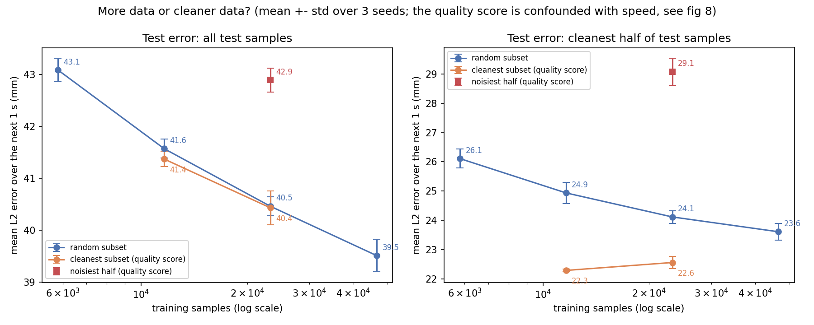
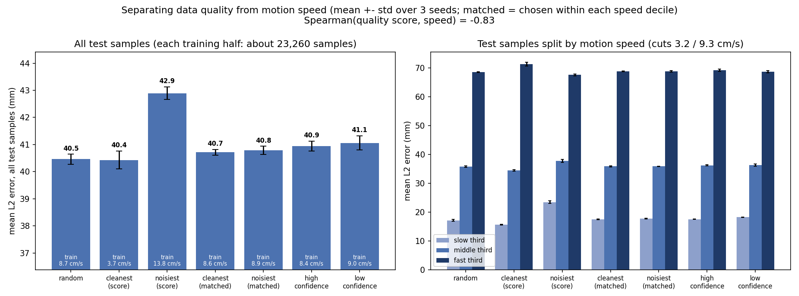

# EgoDex 数据体检：人类操作数据的质量审计

用 Apple 公开的 **EgoDex 测试集**（7.65 小时第一视角灵巧操作，带 3D 手部追踪和语言描述）回答两个问题：

1. 手部追踪数据里的问题（遮挡、跳变、冻结、抖动、左右手互换）有多常见？简单规则能不能查出来？
2. 这些问题会不会真的伤害下游模型？用一个只看关节的小型动作预测模型做对照。

另外准备了语言标注（GPT-4 自动生成的动作描述）的人工复核工具，复核结果出来后再补这一部分。

> 背景：用人类第一视角数据训练机器人，是扩大数据规模的主要路线之一，但「有效数据」不是自动得来的。追踪会丢、会跳、会抖，自动生成的描述也会写错。这个项目想用最小的实验，量化哪些问题常见、哪些查得出来、哪些真的影响模型。

**English summary.** A small, reproducible audit of the public EgoDex test set (7.65 h of egocentric dexterous manipulation with ARKit hand tracking). Hand tracking is stable (wrist jumps in 0.31% of episodes), but about a quarter of hand-frames fall outside the RGB view. Simple rules catch injected jitter, spikes, freezes and left/right swaps (100%, with 0.3% false alarms on clean windows) but miss slow drift. In a joints-only hand-motion predictor, left/right swaps in 30% of training samples raise test error by 30%, while the other defects cost under 0.7 mm; rule-based filtering recovers the loss. The apparent gain from training on "cleaner" data disappears once motion speed is controlled (quality score vs. speed: Spearman −0.83). All numbers are relative comparisons from a weak joints-only model on a self-made split; no data is redistributed.

## 主要发现

1. **追踪本身很稳，主要问题是「看不见」。**手腕跳变、冻结、强抖动都很少（跳变只出现在 0.31% 的片段里）；但有约四分之一的手部帧不在 RGB 画面里，开头还普遍有 1 帧重复。
2. **简单规则查得出突发问题，查不出缓慢漂移。**人为注入的抖动、尖刺、冻结、左右手互换，至少有一条规则 100% 抓到，干净样本的误报只有 0.3%；漂移完全查不出来。
3. **最伤模型的是左右手互换。**30% 的训练样本左右手互换，误差增加 30%；抖动、尖刺、冻结、漂移的影响都不超过 0.7 mm。
4. **规则过滤能挽回损失。**30% 混合缺陷过滤之后，误差回到干净水平，和精确删除所有坏样本的效果一样。
5. **「按分数挑干净数据」的收益是假象。**质量分和动作快慢高度相关（相关系数 −0.83）；控制速度以后，干净一半和噪声一半几乎没有差别。

## 结果

以下数字都来自本仓库脚本在 EgoDex 测试集上的一次完整运行（2026-11-17）。

### 1. 数据盘点

- 共 3,243 段、111 个任务、7.65 小时。每段时长中位数 5.4 秒（10% 分位 2.0 秒，90% 分位 16.2 秒，最长 174.6 秒）。
- 压缩包里 6,486 个文件逐个校验 CRC，全部通过。每个 HDF5 文件都有 69 个位姿（68 个关节加相机），float32 格式，没有 NaN。
- 454 段（14.0%）没有置信度。
- 任务类型：可逆任务 2,240 段，带「这段该用哪条描述」字段（用第 1 条的 1,220 段，用第 2 条的 1,020 段）；需复位 619 段；免复位 384 段。

### 2. 手部追踪体检



| 检查 | 结果 |
|---|---|
| 手腕一帧跳 10 cm 以上 | 0.31% 的片段（约 10 段） |
| 头戴相机一帧跳 10 cm 以上 | 0.03%（1 段） |
| 整只手连续 5 帧以上完全不动 | 0 段 |
| 整帧重复（双手和相机都和上一帧完全相同） | 2,366 段（73%）各有 1 帧。其中 2,353 帧在开头 10 帧内，抽查显示就是第 2 帧和第 1 帧完全相同 |
| 手腕抖动（和平滑轨迹的均方根距离） | 中位数左手 0.23 mm、右手 0.67 mm。超过 2 mm 的片段占 4.3%，超过 5 mm 的占 0.12% |
| 骨长变化 | 每段内骨长完全不变（变异系数为 0）。ARKit 把骨架长度锁死了，这条规则在这份数据上没用 |
| 手腕置信度为 0 | 左手 7.3% 的帧、右手 1.2% 的帧。其中 92%（左）和 84%（右）的帧，手腕投影在 RGB 画面外 |
| 手腕在画面范围内、置信度却为 0 | 占画面内手部帧的 0.50%，集中在手伸进容器的任务：装袋 9.4%、冰箱 8.5%、放食物 6.2% |
| 手腕在 RGB 画面外 | 占全部手部帧的 25.5%。ARKit 仍在追踪，但视频里看不到 |



对使用这份数据的人有用的几点：

1. **追踪本身很稳。**跳变、冻结、强抖动都很少。
2. **真正要注意的是「看不见」。**约四分之一的手部帧不在 RGB 画面里。如果用「画面 + 动作」训练策略，这部分动作标签在画面上找不到对应。
3. **置信度要按关节看。**手腕被检测到时，置信度中位数是 0.99；但整只手的平均置信度只有 0.54 左右，因为手指关节的置信度普遍偏低。如果拿固定的 0.5 当低置信度阈值，有置信度的片段里 76% 会被标成有问题，所以这个阈值不能直接用。
4. **开头有重复帧。**73% 的片段第 2 帧和第 1 帧完全相同，用开头几帧算速度时要跳过。
5. **画面内的丢失多半是遮挡。**投影只能判断手腕是否落在画面范围内，判断不了它是不是被物体挡住了。「画面内丢失」集中在装袋、放冰箱这类任务，更可能是被容器挡住，而不是追踪器出错。

### 3. 规则能不能查出问题（合成缺陷）



从 3,334 个干净的 2 秒窗口里抽 400 个，人为注入缺陷。报警阈值取 12,436 个真实窗口上的第 95 百分位：每条规则最多对 5% 的真实窗口报警，四条规则合起来报警 9.9%。

| 注入的缺陷 | 至少一条规则抓到的比例 |
|---|---|
| 抖动：σ = 2、5、10 mm | 100%、100%、100% |
| 尖刺：偏移 3、10、30 cm，持续 2 帧 | 100%、100%、100% |
| 冻结：5、15、30 帧 | 100%、100%、100% |
| 左右手互换（这次抽到的样本两手间距都在 10 cm 以上） | 100% |
| 缓慢漂移：2 秒内漂 2、5、10 cm | 0.3%、0.3%、0.3%，和干净样本的误报率一样，等于没查出来 |
| 干净样本（不注入） | 误报 0.3% |

说明：
- 缺陷是注入到「干净窗口」上的，这是最容易查的情况。真实数据里自然抖动更大，小幅抖动更难分出来。
- 检出率只说明规则对人为缺陷有多敏感，不是真实错误率。
- 突发问题（抖动、尖刺、冻结、互换）好查。缓慢漂移这类问题，只看一条手腕轨迹的规则很难查出来，要靠别的信号，比如和视频对齐检查，或者用手臂关节链做一致性检查。

### 4. 数据质量对动作预测的影响

任务：用过去 1 秒的 12 个关键点（两只手腕加 10 个指尖），预测未来 1 秒。模型是只看关节的小型 MLP。65,347 个样本按片段分成训练 46,525、验证 6,898、测试 11,924。每组训练 3 个随机种子，下面的数字是平均值。

**先看清这个模型有多弱。**「手不动」基线（预测手在未来 1 秒原地不动）在全部测试样本上误差 42.2 mm，用全部训练数据的 MLP 是 39.5 mm，只好 6%。常速外推更差，是 77.8 mm。只看过去 1 秒的关节、不看画面，很难猜准手接下来往哪走。所以下面只比较不同训练集之间的**相对**差别，不代表真正的动作预测水平。



图中红色虚线是「手不动」基线。在全部测试样本上，除了「最噪的一半」（42.9 mm），其他训练集都比基线好 0.3～2.7 mm。在干净测试集上，没有一种训练集比基线（22.3 mm）好，最接近的是「最干净的一半」（22.6 mm）。

#### 4a. 哪类缺陷最伤模型



从训练数据里随机取一半，再让其中 30% 的样本带上某一种缺陷，和不加缺陷相比（全部测试样本，同种子配对）：

| 缺陷（30% 的训练样本） | 实验 3 规则能抓到 | 额外误差（均值 ± 标准差） |
|---|---|---|
| 左右手互换 | 100% | **+11.94 ± 0.17 mm（+30%）** |
| 尖刺 10 cm（2 帧） | 100% | +0.62 ± 0.25 mm |
| 冻结 15 帧 | 100% | +0.37 ± 0.24 mm |
| 抖动 σ = 10 mm | 100% | +0.25 ± 0.27 mm |
| 漂移 10 cm / 2 秒 | 0.3% | −0.22 ± 0.18 mm |

3 个种子之间的波动约 0.2～0.3 mm，所以小于 0.5 mm 的差别不能当成真实差别。

真正伤模型的是「对应关系错了」的缺陷：左右手一互换，标签就变成了另一只手的运动。抖动、尖刺、冻结这类噪声，在用均方误差训练时基本被平均掉了。规则查不出来的漂移，对这个任务也没有可见的影响。所以质检的优先级应该是：先查左右手、时间对应这类结构性错误，再管噪声。

#### 4b. 规则过滤能挽回多少



| 训练集（都来自同一个随机一半） | 样本数 | 误差（全部测试） |
|---|---|---|
| 不加缺陷 | 23,262 | 40.5 mm |
| 30% 混合缺陷（五类各约占五分之一），不过滤 | 23,262 | 41.9 mm |
| 用实验 3 的规则过滤后 | 约 15,800 | 40.6 mm |
| 精确删掉所有坏样本（理想上限） | 16,284 | 40.9 mm |

- 30% 混合缺陷让误差增加 1.42 ± 0.20 mm，代价大约相当于把训练数据砍掉一半：从全部数据换成一半，误差增加 0.95 ± 0.44 mm。10% 混合缺陷只增加 0.16 ± 0.18 mm，在波动范围内。
- 规则过滤每次删掉约 7,460 个样本，其中约 5,780 个是坏样本：抓到了 83% 的坏样本，删掉的样本里 78% 确实是坏的。另外误删了约 1,680 个本来没问题的样本。
- 过滤后误差比干净数据只多 0.10 ± 0.33 mm，等于回到了干净水平，和理想上限一样好。原因是最伤的左右手互换全被抓到了，漏掉的主要是无害的漂移。

#### 4c. 数据量和数据质量



- 随机取 1/8、1/4、1/2、全部训练数据，误差依次是 43.1、41.6、40.5、39.5 mm，数据量每翻一倍，误差降低约 1～1.5 mm。
- 按质量分挑出「最干净」的一半：在全部测试样本上是 40.4 mm，和随机一半一样；在「干净测试集」上是 22.6 mm，比随机一半的 24.1 mm 好。「最噪」的一半明显更差：全部测试 42.9 mm，干净测试 29.1 mm。
- 不过，质量分里的「最大步长」和「抖动」与动作快慢强相关，所以「最干净」的一半同时也是「动作最慢」的一半，在干净测试集上的优势可能只是分布更接近。下一节把这个混淆拆开。

#### 4d. 拆开「质量」和「动作快慢」



质量分和样本的平均手腕速度高度相关（Spearman 相关系数为 −0.83）：分数越「干净」，动作越慢。测试样本按速度分成三档（分界点 3.2 cm/s 和 9.3 cm/s）。每种训练集都是 23,262 个样本，只有两组速度匹配的是 23,260 个（按十分位取整，少了 2 个）：

| 训练集（一半数据） | 训练集平均速度 | 全部测试 | 慢 | 中 | 快 |
|---|---|---|---|---|---|
| 随机 | 8.7 cm/s | 40.46 | 17.10 | 35.74 | 68.54 |
| 质量分最高 | 3.7 cm/s | 40.43 | **15.56** | 34.39 | 71.33 |
| 质量分最低 | 13.8 cm/s | 42.89 | 23.41 | 37.72 | **67.55** |
| 每个速度段内质量分最高 | 8.6 cm/s | 40.71 | 17.47 | 35.86 | 68.81 |
| 每个速度段内质量分最低 | 8.9 cm/s | 40.78 | 17.70 | 35.85 | 68.81 |
| 置信度最高 | 8.4 cm/s | 40.95 | 17.45 | 36.21 | 69.17 |
| 置信度最低 | 9.0 cm/s | 41.06 | 18.20 | 36.28 | 68.69 |

（单位 mm，3 个种子的均值；种子之间的标准差在 0.1～0.6 mm 之间）

- **不控制速度时**，「最干净的一半」在慢动作上更准、在快动作上更差，「最噪的一半」正好相反。这是训练和测试的快慢分布匹不匹配造成的，不是数据质量的作用。
- **控制速度以后**，干净一半和噪声一半在全部测试样本上只差 0.07 mm，慢、中、快三档的差别也都在 0.25 mm 以内，和种子之间的波动差不多。
- **只按追踪置信度挑**，高低两半差 0.1 mm，同样没有收益。
- **任何非随机挑选都比随机一半略差**（0.3～0.6 mm），说明挑数据本身会让训练分布偏离测试分布。

结论：在 EgoDex 这种追踪本来就很稳的数据上，按规则分数「挑干净数据」对这个任务没有可见收益。真正有用的是两件事：一是找出并删掉结构性错误（4a、4b），二是保持数据在速度、任务等方面的代表性。

### 5. 语言标注复核（等人工）

- 按任务分层抽了 80 段（覆盖 80 个任务，其中 55 段是可逆任务），随机种子固定为 20261117。
- 复核页 `data/review/review.html` 里，每一段左边是视频，右边是数据实际使用的那条描述，要判断两件事：描述对不对、错在哪；对可逆任务，还要判断「数据选的是哪条」选得对不对。结果自动保存在浏览器里，可以导出 CSV。
- 这一部分需要人工逐段看视频判断，目前**还没有结果**。复核完成后，再计算错误率和错误类型，并测试 VLM 自动检查员能不能找出这些错误。

## 数据和许可

- 数据：EgoDex（Hoque et al., 2025, Apple, [arXiv:2505.11709](https://arxiv.org/abs/2505.11709)），官方仓库 [apple-aiml-research/ml-egodex](https://github.com/apple-aiml-research/ml-egodex)。
- 数据许可：**CC BY-NC-ND**。本仓库**不包含任何数据**，也不发布加工后的数据（筛选子集、修正轨迹、缓存、叠加了骨架的画面都不发布）。这里只有代码、汇总统计和图表，别人需要自己从官方地址下载数据后复现。
- 只用了测试集（`test.zip`，17,304,529,397 字节，约 16 GB）。

## 怎么运行

环境：Python 3.10 以上，`pip install -r requirements.txt`（numpy、h5py、pandas、scipy、matplotlib、torch，复核页另外要 opencv-python）。只用 CPU，不需要 GPU。

```bash
# 1. 下载测试集（16 GB，可断点续传）
curl -L -C - -o data/raw/test.zip "https://ml-site.cdn-apple.com/datasets/egodex/test.zip"

# 2. 一键跑完全部步骤（Windows）
run_all.cmd
```

也可以分步运行（在仓库根目录执行，`-I` 让 Python 不从当前目录导入模块）：

| 步骤 | 命令 | 产出 |
|---|---|---|
| 0 校验并解压 | `python -I src/extract_zip.py` | 逐个文件校验 CRC 后解压到 `data/egodex_test/` |
| 1 数据盘点 | `python -I src/inspect_data.py` | `outputs/inventory_summary.json` |
| 2 手部追踪体检 | `python -I src/quality_metrics.py` | `outputs/quality_summary.json` |
| 2b 追问：重复帧、出画面、描述字段 | `python -I src/analyze_findings.py` | `outputs/findings.json`、`outputs/task_view_tracking.csv` |
| 3 合成缺陷检出 | `python -I src/inject_defects.py` | `outputs/injection_summary.csv`、`injection_meta.json` |
| 4 动作预测对照（5 组实验，共 69 次训练，CPU 约 25 分钟；中断后重跑会接着跑） | `python -I -u src/train_predictor.py` | `outputs/predictor_runs.csv`、`predictor_summary.csv`、`predictor_meta.json` |
| 5 出图 | `python -I src/make_figures.py` | `outputs/figures/fig1`～`fig8` |
| 语言复核页 | `python -I src/prepare_language_audit.py` | `data/review/review.html`（本地用，含数据内容，不发布） |

EgoDex 的 MP4 是 MPEG-4 Part 2 编码，浏览器不能直接播放。复核页脚本会把抽到的 80 段转成 640×360、15 帧每秒的 WebM（VP8）副本，放在 `data/review/videos/`，原视频不动。

逐段、逐窗口的明细表写在 `data/derived/`，因为它们由数据直接计算而来，只留在本地。

## 方法要点

- **检查对象**：每只手 25 个关节（手腕加 24 个手指关节），坐标是 ARKit 世界坐标系，单位米，30 帧每秒。
- **规则**（阈值都是看数据前按物理常识定的）：
  - 跳变：手腕一帧移动超过 10 cm（相当于超过 3 m/s）；
  - 冻结：整只手 25 个关节一帧内都没动（小于 1 微米）；
  - 抖动：手腕轨迹和 Savitzky-Golay 平滑结果（窗口 9 帧、2 次多项式）之间的均方根距离；
  - 左右手互换：两只手在同一帧同时跳变；
  - 遮挡：官方置信度为 0 的帧占比。
- **合成缺陷检验**：从「干净」的 2 秒窗口里抽样，人为注入抖动、尖刺、冻结、左右手互换和缓慢漂移，看规则能抓到多少。报警阈值取所有真实窗口上的第 95 百分位，也就是最多对 5% 的真实窗口报警。
- **动作预测对照**：用过去 1 秒的 12 个关键点（两只手腕加 10 个指尖）预测未来 1 秒，坐标换到当前帧的相机坐标系，模型是一个小型 MLP。评价指标沿用 EgoDex 论文的 best-of-K 距离（K = 1）。所有训练集都来自同一个按片段的划分，每组跑 3 个随机种子，共 5 组实验：
  - 质量：随机一半、质量分最高的一半、最低的一半、全部数据，以及随机一半里有 10% 或 30% 样本被人为损坏；
  - 数据量：随机 1/8、1/4，以及质量分最高的 1/4；
  - 缺陷类型：随机一半里 30% 的样本只带一种缺陷（抖动、尖刺、冻结、左右手互换、漂移）；
  - 质检过滤：30% 混合缺陷的训练集，先用实验 3 的规则过滤再训练，并和精确删掉坏样本的理想上限比较；
  - 速度对照：只按置信度挑一半，或在每个速度十分位段里按质量分挑一半（保证快慢分布不变）；测试时再按动作速度分成慢、中、快三档分别统计误差。

## 局限

- 只用了 7.65 小时的测试集，并且自己按片段划分了训练、验证和测试，所以数字**不能**和 EgoDex 论文的基准分数比较。
- 合成缺陷不等于真实缺陷。检出率只说明规则对「人为注入的缺陷」有多敏感，**不是**真实错误率，也不是准确率。
- 缓慢漂移、时间不同步这类问题，只看单条轨迹的规则很难查出来。
- 「质量分」是这个项目自己定义的（几条规则的排名平均），「更干净」只表示在这些规则下更干净；而且它和动作快慢强相关，见 4d。
- 动作预测模型只看关节、不看画面，只比「手不动」基线好 6%，结论只适合做相对比较。换成看画面的模型以后，各类缺陷的伤害大小可能不同。
- 没有人工真值来核对追踪本身准不准。官方 README 也提醒，2D 重投影和画面里的手可能对不齐，原因是视频由多个摄像头合成时带来的视角偏差。

## 许可

- 本仓库的代码使用 MIT 许可证，见 `LICENSE`。
- 本仓库不包含 EgoDex 数据。数据由 Apple 以 CC BY-NC-ND 许可发布，请从官方地址下载，并遵守它的非商业、禁止演绎条款。
- `outputs/` 里的统计结果和图表是根据 EgoDex 计算出来的，仅供非商业研究参考。

## 致谢和说明

- 数据和官方工具来自 Apple 的 EgoDex 项目，骨架关节名和评测指标的定义参考了官方仓库。用到数据时请引用：

```bibtex
@misc{egodex,
      title={EgoDex: Learning Dexterous Manipulation from Large-Scale Egocentric Video},
      author={Ryan Hoque and Peide Huang and David J. Yoon and Mouli Sivapurapu and Jian Zhang},
      year={2025},
      eprint={2505.11709},
      archivePrefix={arXiv},
      primaryClass={cs.CV},
      url={https://arxiv.org/abs/2505.11709},
}
```

- 分工：研究方向（人类操作数据的质量）和实验要求由作者提出。实验设计、代码编写和运行主要由 AI 编程助手 Claude Code 完成。作者负责检查结果、提出修改意见，以及语言标注的人工复核（进行中）。
